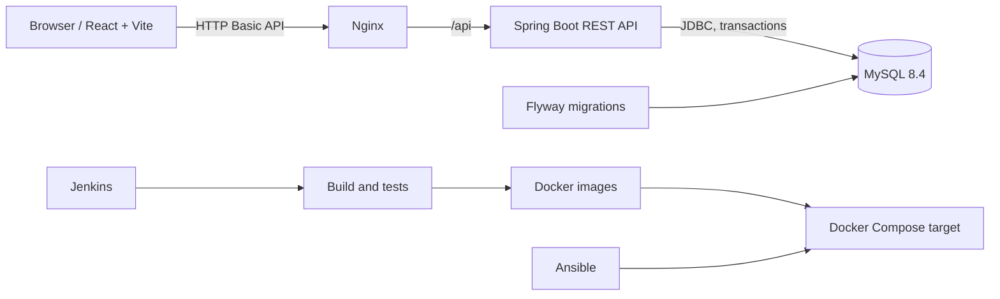
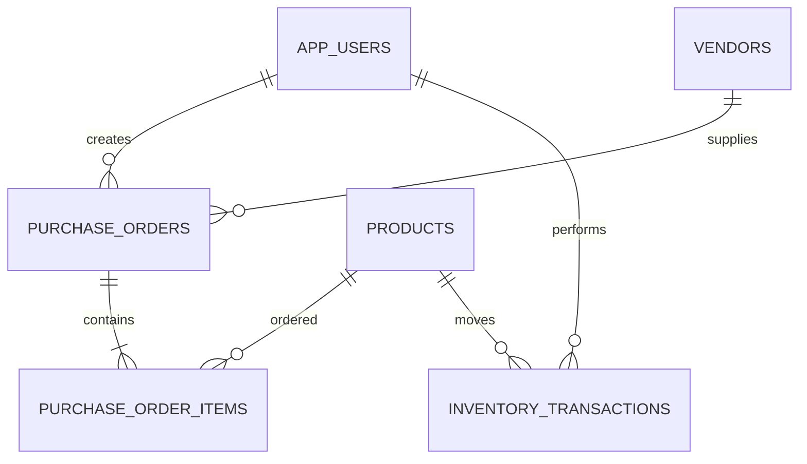

# Architecture and data model

## Relational model

Tables: `app_users` (unique username, BCrypt hash, role and optional vendor link), `vendors` (unique email), `products` (unique SKU and nonnegative stock constraints), `purchase_orders` (unique PO number, vendor and creator foreign keys, indexed status/date), `purchase_order_items` (quantity and price snapshot), `inventory_transactions` (signed quantity changes and user/product references), and `audit_logs` (future service-level audit expansion). Flyway owns schema; Hibernate validates it. Vendor accounts are scoped to one vendor on vendor and order reads.

## Security and data flow
Spring Security uses BCrypt and HTTP Basic; method-level role checks protect mutations. The application bootstraps an admin only when a password environment variable is provided, and never overwrites an existing account. REST input uses bean validation, database writes use parameterized SQL, and purchase order create/receive/stock changes run within transactions. Configure TLS at the edge and replace Basic auth with OIDC before production.
