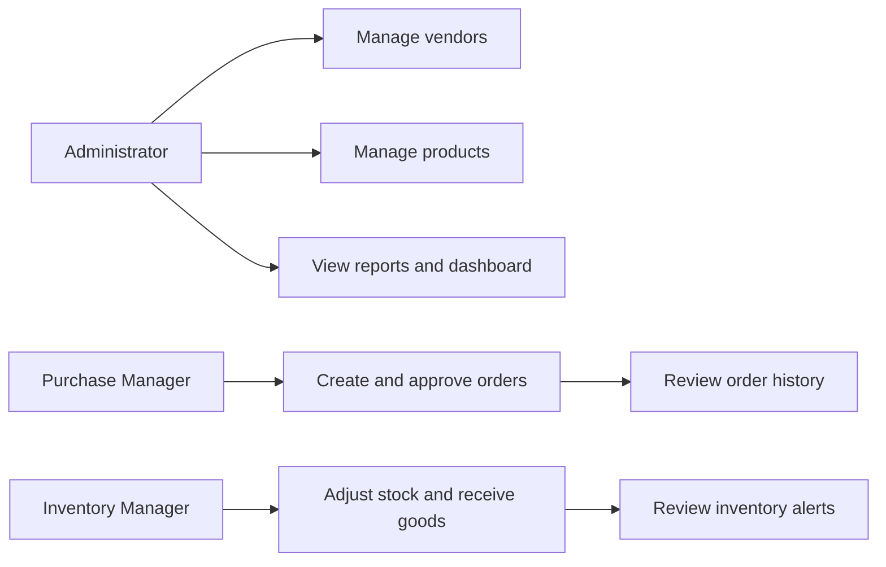

# Software Requirements Specification

## Project
Vendor Purchase Order Portal, Shreyansh Chauhan (23102B0017), BE CMPN B, 15 weeks.

## Problem and scope
Procurement workflows spread across spreadsheets and email make supplier information, item availability, approvals and receipts hard to track. This MVP centralizes vendor and product records, purchase orders, status transitions, stock receipts and adjustments, alerts and reports. It is intended for an academic demonstration and a single organization.

## Roles and use cases
- Administrator: manage directory and products, create and progress orders, adjust inventory, view reporting.
- Purchase Manager: manage vendors, products? (product writes are Inventory Manager only), create purchase orders, approve and order approved purchases.
- Inventory Manager: maintain products and stock, receive ordered goods, view inventory activity.
- Vendor role: read-only access to its own vendor record, its own dashboard summary and purchase order history; it cannot view other vendors' orders or internal products, stock, reports, or alerts.

## Functional requirements
1. Sign-in uses Spring Security with BCrypt password hashes; administrator bootstrap reads environment variables.
2. Dashboard totals, order status counts, recent orders, and low stock are queried from MySQL.
3. Vendors support search, create, update and administrator deactivation with email uniqueness.
4. Products support search, create, update, administrator deactivation, unique SKU, nonnegative pricing/stock and reorder thresholds.
5. Orders bind a vendor and one or more product lines, snapshot unit price, calculate subtotal, and move through PENDING → APPROVED → ORDERED → RECEIVED, with cancellation from pending/approved/ordered.
6. Receiving adds ordered quantities to stock once as a status transition and records inventory movements transactionally. Order creation does not reserve/decrease stock.
7. Inventory adjustments record an audit transaction and reject negative quantity.
8. Search and status filters are provided. Order list accepts `page` and `size` query parameters; advanced sorting/date controls are future work.
9. Low-stock and pending-approval alerts are database-backed. CSV order export and vendor, inventory and status reports are available.
10. Health, OpenAPI documentation, container health checks, automated tests and deployment configuration support operations.

## Non-functional requirements
- Relational integrity, unique SKU/email/PO number, validation, bounded page size, transactional receipt and safe parameterized SQL.
- Responsive accessible HTML form labels and mobile navigation.
- Secrets are externalized; environment placeholders are development-only.
- Automated unit/integration and browser test scaffolding; no test status is asserted until executed.

## Use-case diagram

## Acceptance
Application APIs, browser flows, MySQL migrations, CI/CD definitions and user/developer documentation must be verified in a configured environment. Current workspace limitation and remaining verification tasks are listed in `EVIDENCE.md`.
