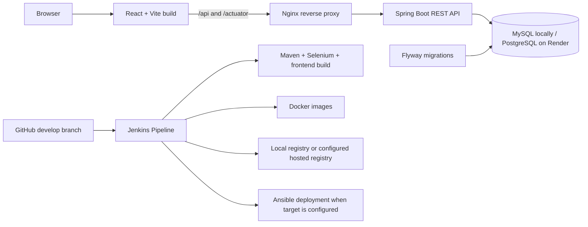

# Vendor Purchase Order Portal: User and Developer Manual

This manual covers local installation, portal workflows, architecture, technology choices, and the DevOps toolchain. It describes the repository as it exists today; deployment notes call out any external setup that is still required.

## 1. What the application does

The portal is a procurement MVP for maintaining vendors and products, creating purchase orders, approving and receiving them, tracking stock, and viewing reports. It is a role-based web application with a React browser interface and a Spring Boot REST API.

The first account is an administrator created at backend startup when `ADMIN_USERNAME` and `ADMIN_PASSWORD` are set. The application does not overwrite an existing user's password and does not seed vendors or products. Add those from the portal after the first sign-in.

## 2. Technology stack: what, where, and why

| Technology | Where it is used | Why it is used |
|---|---|---|
| React 19 | `frontend/src/` | Builds the interactive dashboard and procurement screens from reusable UI components. |
| Vite 7 | `frontend/vite.config.js`, `frontend/package.json` | Provides the frontend development server and production asset build. |
| Axios | Frontend API client in `frontend/src/App.jsx` | Sends JSON requests to the backend and attaches the signed-in user's HTTP Basic credentials. |
| Java 21 + Spring Boot 3.5 | `backend/` | Runs the REST API, validation, application configuration, and health endpoint. |
| Spring Security | `backend/src/main/java/com/vendorportal/SecurityConfig.java` | Authenticates users, stores passwords as BCrypt hashes, and applies route/role restrictions. |
| Spring JDBC (`JdbcTemplate`) | `ApiController.java`, `AuthController.java` | Executes parameterized SQL and transactional procurement/inventory operations. |
| Spring Data JPA / Hibernate | Backend dependencies and `application.yml` | Hibernate validates the Flyway-managed schema at startup; request data access primarily uses JDBC. |
| MySQL 8.4 | Local Docker Compose database | Stores local users, vendors, catalogue, orders, and inventory history. |
| PostgreSQL 16 | Render demo database | Provides the hosted database; separate PostgreSQL Flyway migrations are in `backend/src/main/resources/db/migration-postgresql/`. |
| Flyway | `backend/src/main/resources/db/migration*/` | Creates and evolves the relational schema on application startup. Hibernate is configured to validate rather than create tables. |
| Nginx | `Dockerfile.frontend`, `nginx/default.conf` | Serves the built React app and proxies `/api/` and `/actuator/` to the backend container. |
| Docker / Docker Compose | `Dockerfile.*`, `docker-compose.yml` | Packages the app and runs the frontend, backend, and database together with health checks and persistent database storage. |
| Maven | `backend/pom.xml` | Resolves Java dependencies, compiles the backend, runs unit/integration tests, and packages the executable JAR. |
| JUnit 5 / Spring Boot Test | `backend/src/test/` | Tests order workflow and password hashing, plus the Selenium integration suite. |
| Selenium + Chrome | `PortalE2EIT.java`, integration script | Exercises the UI through a real browser in the integration test container. |
| Playwright | `frontend/e2e/` | Runs browser-based smoke and procurement workflow checks. |
| Git + GitHub | `main`, `develop`, `origin` | Tracks source history and provides the remote repository for collaboration and Render source builds. |
| Jenkins | `Jenkinsfile`, `ci/jenkins/` | Runs the Pipeline as Code CI workflow: builds, tests, archives evidence, and can publish images/deploy when credentials and targets are configured. |
| Docker Registry v2 | Local Jenkins demonstration | Receives tagged images at `localhost:5000` without requiring a paid hosted registry. |
| Ansible Core + `community.docker` | `ansible/` | Provisions Docker on a configured Linux host, rolls out a selected image tag, checks health, and attempts rollback after a failed release. |
| Render | `render.yaml`, `docs/RENDER.md` | Hosts the free static frontend, API service, and PostgreSQL demo database. |

### Request and build flow



## 3. Local run: recommended Docker Compose method

### Prerequisites

- Windows 10/11 with WSL2 and Ubuntu, or Linux.
- Docker Desktop with its WSL2 backend, or Docker Engine and the Compose v2 plugin inside Ubuntu WSL/Linux.
- Git, if cloning the repository.

### Start from Windows PowerShell

Open PowerShell in the repository root. Create a local environment file and replace the sample values with unique local secrets. Do not commit `.env`.

```powershell
Copy-Item .env.example .env
notepad .env
docker compose up --build -d
docker compose ps
```

Set at least these values in `.env`:

| Variable | Purpose |
|---|---|
| `DB_PASSWORD` | Password for the application database user. |
| `MYSQL_ROOT_PASSWORD` | Local MySQL root password used by the container health check. |
| `ADMIN_USERNAME` | Initial administrator username (usually `admin`). |
| `ADMIN_PASSWORD` | Initial administrator password. Compose refuses to start if it is missing. |
| `HTTP_PORT` | Browser port; defaults to `8088`. |

Open [http://localhost:8088](http://localhost:8088). Sign in using the administrator values from `.env`. Check backend health at [http://localhost:8088/actuator/health](http://localhost:8088/actuator/health); healthy response contains `"status":"UP"`. API documentation is at [http://localhost:8088/swagger-ui.html](http://localhost:8088/swagger-ui.html).

### Ubuntu WSL-specific local access

If Docker Engine is running inside Ubuntu WSL, the first run can use the integration launcher from Windows PowerShell:

```powershell
.\scripts\run-integration.ps1
```

It creates/reuses local secrets outside the repository in `~/.config/vendor-portal/.env` (mode 0600), starts the app, and runs browser checks; the Compose stack remains running afterward. Later, start the stack without rerunning the tests with `wsl.exe -d Ubuntu -u root -- bash /mnt/c/Users/areyy/OneDrive/Documents/ChatGPT/Vendor-Purchase-Order-Portal/scripts/start-compose-wsl.sh`.

If Windows cannot reach `localhost:8088`, open **Administrator PowerShell** in the project folder and run:

```powershell
.\scripts\fix-wsl-localhost.ps1
```

The helper listens on Windows loopback only and forwards port 8088 to the current Ubuntu WSL address. Run it again after WSL restarts if its address changes. It refuses to overwrite an unrelated port-forward rule.

### Stop and preserve data

```powershell
docker compose down
```

This stops containers and preserves the named `mysql-data` database volume. **Only run `docker compose down -v` if you intentionally want to permanently delete the local database and all portal records.**

Useful diagnostics:

```powershell
docker compose ps
docker compose logs --tail 100 backend
docker compose logs --tail 100 frontend
docker compose logs --tail 100 db
```

## 4. Native developer run (without Docker for the app)

This mode still needs a reachable MySQL 8 database. Install Java 21, Maven 3.9+, Node.js 24, and npm 11. Create an empty database and set the environment variables below in the terminal used for the backend:

```powershell
$env:DB_URL = 'jdbc:mysql://localhost:3306/vendor_portal?serverTimezone=UTC'
$env:DB_USER = 'portal'
$env:DB_PASSWORD = '<your-local-db-password>'
$env:ADMIN_USERNAME = 'admin'
$env:ADMIN_PASSWORD = '<your-local-admin-password>'
```

Start the API in one terminal:

```powershell
Set-Location backend
mvn spring-boot:run
```

Start the UI in a second terminal:

```powershell
Set-Location frontend
npm ci
npm run dev
```

Open the Vite URL printed by `npm run dev` (normally `http://localhost:5173`). Vite proxies `/api` and `/actuator` to the API at `http://localhost:8080`. Flyway applies the MySQL migrations when the API starts.

## 5. How to use the portal

### First login and initial data

1. Start the app and sign in with `ADMIN_USERNAME` and `ADMIN_PASSWORD`.
2. Add vendors from **Vendors → Add vendor**. Email must be unique.
3. Add products from **Products → Add product**. Supply a unique SKU, category, nonnegative INR unit price, opening stock, and reorder threshold. Initial stock is recorded in inventory history.
4. Optional: create role-specific team accounts from `POST /api/users` (Admin-only API). The UI currently does not provide a user-management page.

### Create and receive a purchase order

1. Open **Purchase orders → New order**.
2. Select a vendor and product, enter a positive quantity, and add optional notes.
3. The system creates a `PENDING` PO with a unique PO number and snapshots the product's current unit price.
4. A user with the **Admin** or **Purchase Manager** role advances it from `PENDING` to `APPROVED`, then to `ORDERED`.
5. An **Admin** or **Inventory Manager** advances `ORDERED` to `RECEIVED`. Receipt adds the ordered quantity to product stock and records an inventory transaction.

The allowed workflow is `PENDING → APPROVED → ORDERED → RECEIVED`. The application workflow validator also recognizes cancellation where permitted by the workflow implementation. Invalid transitions return a conflict response.

### Inventory, alerts, and reports

- **Inventory** shows quantities and reorder thresholds. Admins and Inventory Managers can adjust a count; every adjustment records the signed quantity change and a note.
- **Alerts** lists products at or below their reorder threshold and pending orders.
- **Reports** summarizes purchases by vendor, inventory by category, and orders by status. **Export orders CSV** downloads an order report.
- The dashboard shows totals, recent POs, status distribution, and low-stock items. Values come from the database, not demo placeholders.

### Roles

| Role | Main capabilities |
|---|---|
| Admin | Manage users through API, vendors, products, orders, inventory, and reports. |
| Purchase Manager | Manage vendors; create and approve/order purchase orders; view procurement reports. |
| Inventory Manager | Manage products and stock; receive orders; view inventory and reports. |
| Vendor | View its linked vendor account and that vendor's purchase orders. Vendor records are scoped by the user's `vendor_id`. |

The browser uses HTTP Basic credentials for API requests and stores the current login in session storage until sign-out or the tab/session is cleared. This is an MVP security setup. Do not expose it directly for sensitive production use; the architecture notes recommend TLS at the edge and an OIDC/session-based identity design for production.

## 6. Tests and build commands

Run backend unit tests and package the application:

```powershell
Set-Location backend
mvn verify
```

Build the frontend:

```powershell
Set-Location frontend
npm ci
npm run build
```

Run the full local Docker/Selenium/Playwright integration suite from the repository root:

```powershell
.\scripts\run-integration.ps1
```

The integration script starts/reuses the Docker Compose app, runs JUnit/Selenium against it, and runs Playwright browser tests. In this workspace, the most recent run passed 4 Maven unit tests, 5 Selenium scenarios, and 6 Playwright scenarios. E2E test credentials are read from the protected WSL secret file or generated for the test run; do not paste them into source files.

## 7. Git, GitHub, and branching

The remote is `git@github.com:freak-dev/Build-vendor-purchase-order-portal.git`; the working branches are `main` and `develop`. Use a short-lived feature branch for new changes:

```powershell
git switch develop
git pull --ff-only origin develop
git switch -c feature/short-description
```

Commit and push your branch, then open a Pull Request into `develop` on GitHub. The Jenkinsfile polls SCM every five minutes; a GitHub webhook is not currently configured. No pull request or review is implied by a successful `git push`.

## 8. DevOps toolchain and how to run it

### Jenkins CI (local, free demonstration)

Run from Windows PowerShell:

```powershell
.\scripts\run-local-ci.ps1
```

The script uses Ubuntu WSL Docker to launch Jenkins at `http://localhost:8081` and a local Docker Registry v2 at `localhost:5000`. It initializes the `vendor-portal-ci` pipeline, checks out local `develop`, runs Maven tests, frontend build, isolated Selenium browser tests, archives reports, builds both Docker images, and pushes tags to the local registry. Jenkins and portal admin credentials are stored in WSL at `~/.config/vendor-portal/.env`, outside Git. Retrieve the Jenkins admin password there; do not paste it into this manual.

The Jenkinsfile is **Pipeline as Code**: the pipeline stages live in source control. Docker Hub publication is opt-in and requires a Jenkins registry credential and registry namespace. The Ansible stage is also gated and will not run until a real target group and credentials are configured.

### Docker image lifecycle

Dockerfiles at repository root build a Java backend image and an Nginx frontend image. Docker Compose builds/runs the local application. Jenkins builds version-tagged images after its test stages and publishes locally to Registry v2 for the community demonstration. A hosted registry (for example Docker Hub) is not demonstrated until a namespace and registry credentials are supplied.

### Ansible provisioning, deployment, health check, and rollback

Ansible configuration is under `ansible/`. It installs Docker on a configured Debian/Ubuntu target, stages a Compose deployment, pulls the chosen image tag, starts the services, and polls the health endpoint. If rollout or health verification fails after a prior deployment exists, the playbook restores the saved Compose release and checks health again.

Before running it, replace the sample address `192.0.2.10` in `ansible/inventory/hosts.yml` with a Linux host you control, configure SSH and sudo, provision the target `.env` out of band, and add Jenkins credentials described in [deployment notes](DEPLOYMENT.md). The sample address is documentation-only; no external VM, SSH credential, registry publishing, remote deployment, or rollback rehearsal is claimed as completed.

Syntax-check the playbook after configuring Ansible:

```bash
ansible-galaxy collection install -r ansible/requirements.yml
ansible-playbook -i ansible/inventory/hosts.yml ansible/playbooks/deploy.yml --syntax-check
```

### Render demo hosting

The Render workspace currently has a free Postgres instance and a live static frontend. The backend API still requires creating/syncing the Blueprint from `develop` in the Render Dashboard. See [Render deployment instructions](RENDER.md). The free database has a 30-day lifetime and is not durable hosting.

## 9. API and troubleshooting references

- REST route list and roles: [API guide](API.md).
- Data model and security boundary: [Architecture](ARCHITECTURE.md).
- Docker/Ansible deployment setup: [Deployment notes](DEPLOYMENT.md).
- Current task evidence and unverified checklist items: [Final audit](FINAL-AUDIT-REPORT.md).
- Report and presentation: [Project report](PROJECT-REPORT.md), [presentation](FINAL-PRESENTATION.html).

Common checks:

| Symptom | Check |
|---|---|
| Login fails | Confirm the right admin password in `.env`; an existing account is not reset by changing that variable. |
| Backend unhealthy | Run `docker compose logs --tail 100 backend` and confirm the DB container is healthy and DB secrets match. |
| UI loads but says API unavailable | Check backend health and the Nginx `/api/` proxy; in Render, the API Blueprint must be deployed and `VITE_API_BASE_URL`/CORS origin must match. |
| Windows cannot open localhost with WSL Docker | Run the loopback forwarding helper from Administrator PowerShell and retry `http://localhost:8088`. |
| Data disappeared after recreation | `docker compose down -v` removes the named database volume; normal `docker compose down` preserves it. |

